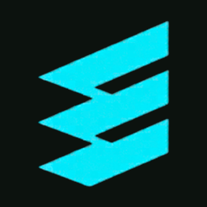

<div align="center">

  

  # EDGELAB DIGITAL SOLUTIONS
  ### *Your Business, Finally Online.*

  [](https://nextjs.org/)
  [](https://react.dev/)
  [](https://www.typescriptlang.org/)
  [](https://tailwindcss.com/)
  [](https://turbo.build/)
  [](LICENSE)

  <p align="center">
    <strong>Bespoke Web Platforms • Digital Operations • Commercial Photography • 4K Vertical Video • Ongoing Care</strong>
  </p>

  <p align="center">
    <a href="https://edgelab.in">Official Domain</a> •
    <a href="https://wa.me/916000156107?text=Hi%20EdgeLab%2C%20I%20would%20like%20to%20discuss%20a%20project.">Direct WhatsApp</a> •
    <a href="https://instagram.com/edgelab.work">Instagram @edgelab.work</a> •
    <a href="mailto:edgelab.work@gmail.com">edgelab.work@gmail.com</a>
  </p>

</div>

---

## 📑 Table of Contents

- [1. Executive Summary](#1-executive-summary)
- [2. The EdgeLab Philosophy](#2-the-edgelab-philosophy)
- [3. Live Flagship Productions](#3-live-flagship-productions)
- [4. Platform Architecture & Route Catalog](#4-platform-architecture--route-catalog)
- [5. Intelligent AI Concierge Engine](#5-intelligent-ai-concierge-engine)
- [6. Commercial Capabilities & Services](#6-commercial-capabilities--services)
- [7. Transparent Investment Tiers](#7-transparent-investment-tiers)
- [8. Technology Stack & Engineering Standards](#8-technology-stack--engineering-standards)
- [9. Repository Structure](#9-repository-structure)
- [10. Quick Start & Local Setup](#10-quick-start--local-setup)
- [11. Production Build & Deployment](#11-production-build--deployment)
- [12. Studio Contact & Support](#12-studio-contact--support)

---

## 1. Executive Summary

**EdgeLab Digital Solutions** is a premier creative technology studio and end-to-end digital partner engineered for ambitious Indian and global businesses. 

Most growing companies struggle with a fragmented digital presence:
- A freelance developer builds an unoptimized website that loads slowly.
- A local photographer takes raw photos that don't match the website layout.
- Social media reels are disconnected from actual business conversion funnels.
- After launch day, freelancers disappear, leaving menus, prices, and security unmaintained.

**EdgeLab eliminates this friction completely.** We deliver a unified, single-partner digital infrastructure combining bespoke hand-written software, commercial cinema visual production, local search dominance, and 24/7 technical continuity.

---

## 2. The EdgeLab Philosophy

```
┌────────────────────────────────────────────────────────────────────────┐
│                        THE EDGELAB SYSTEM                              │
├─────────────────┬───────────────────┬──────────────────┬───────────────┤
│  01. ENGINEER   │   02. PRODUCE     │   03. CONNECT    │  04. MAINTAIN │
│  Bespoke Next.js│  On-Location 4K   │  Local Google    │  Uptime Care  │
│  Zero Templates │  Commercial Video │  Maps Ranking    │  Weekly Price │
│  0.34s LCP Edge │  Studio Lookbooks │  WhatsApp Routing│  & Menu Sync  │
└─────────────────┴───────────────────┴──────────────────┴───────────────┘
```

- **Zero Template Bloat**: We never use generic WordPress themes, slow Wix builders, or cookie-cutter templates. Every platform is built from scratch on **Next.js 16**, ensuring 99/100 Google PageSpeed scores.
- **Conversion-First UX**: Sleek Dark Olive (`#121C15`), Porcelain White (`#FFFFFF`), and Emerald Accent (`#10B981`) color harmonies built for authoritative brand positioning.
- **Direct WhatsApp Funnel**: Instant 1-click lead routing that connects high-intent customer inquiries directly with business owners.

---

## 3. Live Flagship Productions

Explore EdgeLab's active, production-grade digital platforms:

### 🌟 01. NOIRÉ Couture & Luxury Atelier
> **Immersive Digital Runway & Visual Commerce Flagship**  
> 🔗 **Live URL:** [https://noire-couture.netlify.app/](https://noire-couture.netlify.app/)

- **Aesthetic Direction**: High-fashion publication typography (`Newsreader` & `Plus Jakarta Sans`), cinematic video backdrop, and editorial lookbooks.
- **Key Features**:
  - Tactile fabric and drape inspection zoom.
  - Interactive collection narratives and artisan stories.
  - 1-Click fast checkout with zero platform cuts.
  - Sub-second edge caching (**0.31s LCP**).

### 🌟 02. Smart Restaurant & Dining Experience
> **Digital Dining & Real-Time Operational Dispatch Portal**  
> 🔗 **Live URL:** [https://restaurant-live-portal.netlify.app/](https://restaurant-live-portal.netlify.app/)  
> 🔗 **Live Kitchen Admin:** [https://restaurant-live-portal.netlify.app/admin](https://restaurant-live-portal.netlify.app/admin)

- **Workflow**: Physical Table QR Code ➔ Live Mobile Menu ➔ Instant Kitchen Dispatch in < 30 seconds.
- **Key Features**:
  - Interactive digital menu with instant dietary filtering (Veg, Non-Veg, Chef Specials).
  - Real-time kitchen staff queue and table turnover telemetry.
  - Eliminates costly aggregator platform cuts (0% commission).
  - 100% paperless operation.

---

## 4. Platform Architecture & Route Catalog

The EdgeLab platform is built on Next.js 16 App Router across **14 static and dynamic routes**:

| Route | Type | Purpose & Scope |
| :--- | :--- | :--- |
| `/` | `Static` | **Flagship Homepage**: Interactive Hero Console, Value Telemetry, Live Showcase, Capabilities Matrix, FAQ. |
| `/about` | `Static` | **Studio Manifesto**: Why EdgeLab exists, our anti-agency standards, and executive leadership. |
| `/services` | `Static` | **Comprehensive Services Catalog**: In-depth specifications across Web, Systems, Content, Social, and Care. |
| `/work` | `Static` | **Production Portfolio**: Interactive case study explorer with live deployment links and tech metrics. |
| `/ecosystem` | `Static` | **The 6-Station Lifecycle**: Discover how web, reels, photography, search, and care synchronize. |
| `/process` | `Static` | **5-Step Roadmap**: Discover ➔ Strategy ➔ Design ➔ Build ➔ Launch & Grow with clear deliverables. |
| `/pricing` | `Static` | **Commercial Tiers**: Transparent investment breakdown from Starter (₹4,999) to Custom (₹19,999+). |
| `/contact` | `Static` | **Inquiry Terminal**: Interactive scope selector with instant prefilled WhatsApp lead payload. |
| `/api/chat` | `Dynamic (SSR)` | **AI Concierge API**: Enterprise rate-limited endpoint interfacing Ollama LLMs and dialogue engine. |
| `/sitemap.xml` | `Static` | **Dynamic XML Sitemap**: Automated search engine discovery for all indexable pages. |
| `/robots.txt` | `Static` | **Search Crawler Directives**: Fine-tuned indexing rules for Googlebot and Bingbot. |

---

## 5. Intelligent AI Concierge Engine

The EdgeLab platform includes a dedicated, intelligent AI concierge (`ChatbotAssistant.tsx` + `/api/chat`):

```
┌────────────────────────────────────────────────────────┐
│                 CLIENT CHAT INTERFACE                  │
└───────────────────────────┬────────────────────────────┘
                            │ POST /api/chat
                            ▼
┌────────────────────────────────────────────────────────┐
│         IP-BASED RATE LIMITER (30 REQ/MIN)             │
└───────────────────────────┬────────────────────────────┘
                            │
              ┌─────────────┴─────────────┐
              ▼                           ▼
   [Ollama LLM Node]            [EdgeLab Agent Engine]
   • llama3.2 / qwen3.5         • Multi-Turn Memory
   • 15s Timeout Window         • Industry Recognition
   • Real-Time Reasoning        • Instant Plan Tables
              │                           │
              └─────────────┬─────────────┘
                            ▼
           Rich Markdown & WhatsApp Action Chips
```

### Key AI Features:
1. **Multi-Turn Context Awareness**: Remembers if a client mentions an automotive garage, cafe, clinic, or boutique across multiple conversation steps.
2. **Resilient Multi-Host Discovery**: Probes local (`http://127.0.0.1:11434`, `http://localhost:11434`) and remote Ollama clusters with a generous **15-second inference window**.
3. **Graceful Fallback**: If an LLM node is cold-starting, the built-in conversational synthesizer delivers structured pricing tables, car shop packages, and consultation flows without ever repeating static canned text.
4. **Auto-Popup Engagement**: Welcomes first-time visitors after 2.5 seconds with one-click quick action chips.

---

## 6. Commercial Capabilities & Services

```
┌────────────────────────────────────────────────────────────────────────┐
│                        6 CORE CAPABILITIES                             │
├────────────────────────────────────────────────────────────────────────┤
│ 01. Bespoke Web Engineering       │ 04. 4K Vertical Video & Reels      │
│     Next.js 16, sub-second speed, │     High-retention cinematography, │
│     zero template bloat.          │     custom foley & pacing.         │
├───────────────────────────────────┼────────────────────────────────────┤
│ 02. Digital Operations & Portals  │ 05. Local Search & Google SEO      │
│     Table QR ordering, live POS,  │     Google Maps 3-Pack ranking,    │
│     kitchen dispatch sockets.     │     structured schema markup.      │
├───────────────────────────────────┼────────────────────────────────────┤
│ 03. Commercial Studio Photography │ 06. Website Management & Care      │
│     Food styling, store interior, │     Continuous uptime monitoring,  │
│     product catalog shoots.       │     weekly menu updates, SSL care. │
└───────────────────────────────────┴────────────────────────────────────┘
```

---

## 7. Transparent Investment Tiers

| Tier | Investment | Deliverables & Scope | Timeline | Ideal For |
| :--- | :--- | :--- | :--- | :--- |
| **Starter** | **₹4,999** | Bespoke 1-Page Launchpad, Mobile-First UI, Google Maps, WhatsApp Integration | 3–5 Days | Small local establishments & fast launchpads |
| **Business ⭐** | **₹8,999** | **Up to 5 Tailored Pages, Digital Catalog/Menu, Commercial Photography, Local SEO, 1 Mo Care** | **7–10 Days** | **⭐ RECOMMENDED (Car shops, cafes, salons, retail)** |
| **Business Plus** | **₹14,999** | Up to 8 Pages, Dynamic Booking/Order Flow, Social Media Launch Pack, 3 Mo Care | 10–14 Days | Ambitious brands scaling multi-channel presence |
| **Custom App** | **₹19,999+** | Bespoke Web Application, Real-Time Admin/POS Portal, 4K Cinema Video, Priority SLA | 2–3 Weeks | Custom enterprise workflows, e-commerce & portals |

---

## 8. Technology Stack & Engineering Standards

- **Core Framework**: [Next.js 16.3.8](https://nextjs.org/) (App Router, Turbopack, Server-Side Rendering)
- **UI Library**: [React 19.2.8](https://react.dev/)
- **Programming Language**: [TypeScript 5.x](https://www.typescriptlang.org/) (Strict Mode)
- **Styling Architecture**: [Tailwind CSS v4](https://tailwindcss.com/) with custom design tokens:
  - Deep Olive: `#121C15`, `#162319`, `#1A281E`
  - Porcelain White: `#FFFFFF`, `#F9FAF8`
  - Emerald Accent: `#10B981`, `#059669`
- **Typography**: 
  - `Instrument Serif` / `Newsreader` for editorial luxury headlines
  - `Plus Jakarta Sans` for clean, high-legibility interface copy
  - `JetBrains Mono` for telemetry and technical badges
- **Iconography**: [Lucide React](https://lucide.dev/)
- **Smooth Scrolling**: [Lenis](https://lenis.darkroom.engineering/)

---

## 9. Repository Structure

```text
edgelab-official/
├── public/
│   ├── apple-touch-icon.png         # iOS Home Screen Bookmark (180x180)
│   ├── favicon.ico                  # Browser Tab Favicon
│   ├── favicon-16x16.png            # Standard Tab Icon
│   ├── favicon-32x32.png            # High-DPI Tab Icon
│   ├── favicon-192x192.png          # Android PWA Icon
│   ├── favicon-512x512.png          # Splash Icon
│   └── assets/
│       ├── brand/                   # Official EdgeLab Logos & Marks
│       ├── projects/                # Production Screenshots & Media
│       └── showcase/                # High-Res Commercial Photography
├── src/
│   ├── app/
│   │   ├── layout.tsx               # Root Layout, Metadata & Structured JSON-LD
│   │   ├── page.tsx                 # Flagship Homepage
│   │   ├── globals.css              # Design Tokens & Custom CSS Layers
│   │   ├── icon.png                 # Native Next.js App Router Favicon
│   │   ├── apple-icon.png           # Native Next.js Apple Icon
│   │   ├── about/page.tsx           # Studio Manifesto & Team
│   │   ├── services/page.tsx        # 6 Core Capabilities Breakdown
│   │   ├── work/page.tsx            # Production Portfolio Showcase
│   │   ├── ecosystem/page.tsx       # 6-Station Integrated Lifecycle
│   │   ├── process/page.tsx         # 5-Stage Delivery Methodology
│   │   ├── pricing/page.tsx         # 4 Commercial Tiers
│   │   ├── contact/page.tsx         # Inquiry Form & WhatsApp Lead Router
│   │   ├── api/chat/route.ts        # AI Concierge Backend Route
│   │   ├── sitemap.ts               # Automated XML Sitemap Generator
│   │   └── robots.ts                # Search Engine Robots Protocol
│   ├── components/
│   │   ├── home/                    # Homepage Interactive Modules
│   │   ├── layout/                  # Navbar, Footer, ChatbotAssistant
│   │   └── ui/                      # BrandLogo, InstagramIcon, Custom Badges
│   ├── config/
│   │   └── site.ts                  # Centralized Site Directory & Contact Info
│   └── lib/
│       └── utils.ts                 # Tailwind Merge & Class Utilities
├── netlify.toml                     # Netlify Deployment Configuration
├── next.config.ts                   # Next.js Build Options
├── tsconfig.json                    # TypeScript Configuration
└── package.json                     # Project Manifest & Dependencies
```

---

## 10. Quick Start & Local Setup

### Prerequisites
- **Node.js**: `v20.x` or higher
- **Package Manager**: `npm` (v10+), `pnpm`, or `yarn`

### Installation

1. **Clone the repository:**
   ```bash
   git clone https://github.com/SusmitChoudhury/edgelab-website.git
   cd edgelab-website
   ```

2. **Install dependencies:**
   ```bash
   npm install
   ```

3. **Start the local development server:**
   ```bash
   npm run dev
   ```

4. **Open in browser:**
   Navigate to [http://localhost:3000](http://localhost:3000).

---

## 11. Production Build & Deployment

### Build Verification
To run the production compiler and verify TypeScript and routing:
```bash
npm run build
```

### Code Quality & Linter
To verify zero lint errors across all components:
```bash
npm run lint
```

### Production Preview
To serve the optimized production build locally:
```bash
npm run start
```

### Deploying to Netlify
The repository includes a pre-configured `netlify.toml`:
1. Connect your repository to [Netlify](https://app.netlify.com).
2. Set Build Command: `npm run build`
3. Set Publish Directory: `.next`
4. Deploy!

---

## 12. Studio Contact & Support

For new project partnerships, client scoping, or press inquiries:

- **WhatsApp & Phone**: [+91 60001 56107](https://wa.me/916000156107?text=Hi%20EdgeLab%2C%20I%20would%20like%20to%20discuss%20a%20project.)
- **Official Email**: [edgelab.work@gmail.com](mailto:edgelab.work@gmail.com)
- **Instagram**: [@edgelab.work](https://instagram.com/edgelab.work)
- **Official Domain**: [https://edgelab.in](https://edgelab.in)

<br />

<div align="center">
  <sub>Designed & Engineered with precision by <strong>EdgeLab Digital Solutions</strong>. All rights reserved.</sub>
</div>
